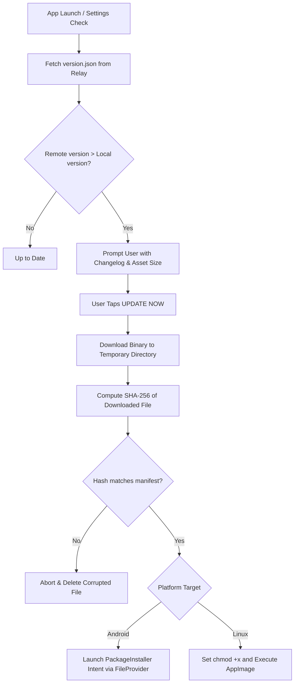
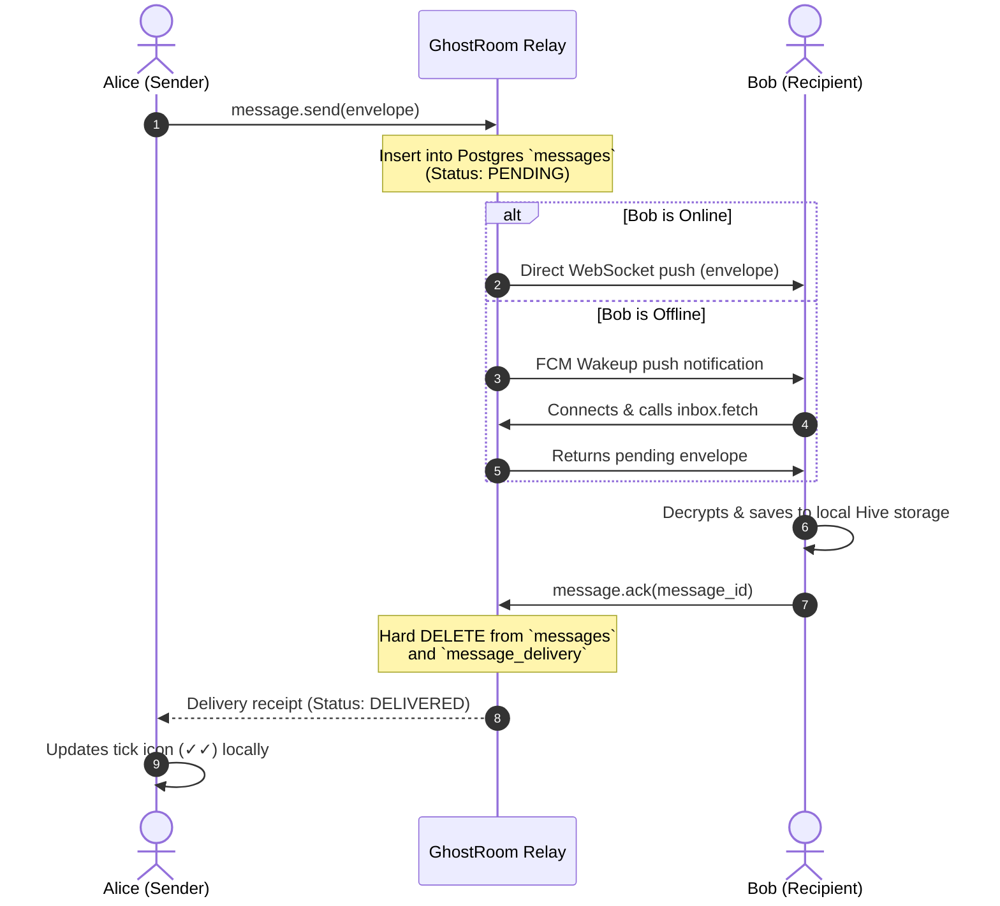

# GhostRoom System Architecture

## 1. Overview & Philosophy

GhostRoom is a sovereign, end-to-end encrypted (E2EE), zero-knowledge messaging system designed with a strict **store-and-forward privacy model** (similar to Signal and Session):

1. **No Account System**: No phone numbers, email addresses, or usernames. Identity is an Ed25519/X25519 keypair derived deterministically from a 24-word BIP-39 mnemonic seed.
2. **Dual-Method Vault**: Identities can be backed up and restored via standard 24-word BIP-39 passphrases or portable, encrypted `.ghostkey` JSON keyfiles (Argon2id + XChaCha20-Poly1305).
3. **Device as Source of Truth**: All decrypted conversation logs and media history reside strictly in local on-device storage (Hive/SQLite). The relay holds **zero permanent message logs**.
4. **Store-and-Forward Transient Relay**: The server acts purely as an encrypted transit postbox. Messages exist in the relay's PostgreSQL database only while in-flight (status: `PENDING`). The moment the recipient's device receives and acknowledges the message (`message.ack`), it is **permanently purged** from the relay database and cache.
5. **Blind Relaying**: The server cannot inspect message plaintexts, recipient metadata beyond transient routing IDs, or media attachments.
6. **Universal Contact Routing**: Peer discovery and channel initiation take place via universal HTTPS links, App Links, and scannable QR codes without requiring a centralized user registry.

---

## 2. Core Components

```
┌────────────────────────────────────────────────────────────────────────┐
│                          GhostRoom Client                              │
│              (Flutter - Android, Linux, macOS, iOS, Windows)           │
│  - Dual-Method Vault: BIP-39 Mnemonic + Argon2id .ghostkey             │
│  - Libsodium Sumo Cryptography (Ed25519, X25519, XChaCha20-Poly1305)  │
│  - On-Device Encrypted Storage (Hive AES-256)                          │
│  - Deep Link & App Link Router (autoVerify & ghostroom://)             │
│  - SHA-256 Verified Multi-Platform Auto-Updater                       │
│  - Offline Outbox Queue & Real-Time Socket Connection                  │
└───────────────────────────────┬────────────────────────────────────────┘
                                │ WebSocket / TLS (Socket.IO)
                                ▼
┌────────────────────────────────────────────────────────────────────────┐
│                          GhostRoom Relay                               │
│                       (NestJS / TypeScript)                            │
│  - WebSocket Gateway: Real-Time Envelope Routing                       │
│  - Anti-Replay: Ephemeral In-Memory Nonce Challenges (identity.prove)   │
│  - In-Flight Mailbox: Store-and-Forward Queue (PostgreSQL)             │
│  - Zero-Knowledge Media Broker: Presigned S3/R2 URLs & Refcounting     │
│  - Rate Limiter: Per-Identity In-Memory Sliding Window                 │
│  - Push Dispatcher: Instant Background Wakeups (FCM)                   │
│  - Public Portal: Landing (`/`), Downloads (`/download`), Redirects    │
│  - Universal Links: /.well-known/assetlinks.json & apple-app-site-assoc│
└──────────────┬───────────────────────────────┬─────────────────────────┘
               │                               │
     SQL Query │             S3 / Presigned URL│
               ▼                               ▼
┌────────────────────────────────────────┐   ┌───────────────────────────┐
│       PostgreSQL 15/16 Store           │   │ Cloudflare R2 / S3 Store  │
│  - `messages` (Transient in-flight)    │   │  - Encrypted Media Blobs  │
│  - `message_delivery` (Per-device ack) │   │  - Ephemeral Refcounted   │
│  - `devices` (FCM push registrations)  │   │    Object Lifecycles      │
│  - `media_metadata` (Refcounts)        │   │  - Release Binaries & APKs│
└────────────────────────────────────────┘   └───────────────────────────┘
```

---

## 3. Dual-Method Cryptographic Identity Model

GhostRoom separates master key generation from device-specific storage, offering two complementary backup and recovery mechanisms:

### A. BIP-39 Mnemonic Passphrase
- 256 bits of entropy generate a standard 24-word BIP-39 mnemonic phrase.
- PBKDF2 with HMAC-SHA512 derives a 64-byte seed.
- Master Ed25519 keypair (`eid`) and Curve25519 keypair (`xid`) are derived deterministically via Libsodium.

### B. Portable `.ghostkey` Encrypted JSON Vault
During onboarding or from settings, users can export a portable, hardware-encrypted `.ghostkey` file. The vault encapsulates the encrypted private seed, public ID, salt, and KDF parameters:

```json
{
  "ghostroom_keyfile": "ghostkey",
  "version": 1,
  "public_id": "8KxM...Base58",
  "fingerprint": "A1B2 C3D4 ... Safety Number",
  "kdf": {
    "algorithm": "argon2id13",
    "salt_hex": "7a3f81...32bytes",
    "ops_limit": 2,
    "mem_limit": 67108864
  },
  "cipher": {
    "algorithm": "xchacha20poly1305_ietf",
    "nonce_hex": "c4d1...24bytes",
    "ciphertext_hex": "9e12...encrypted_payload"
  },
  "created_at": "2026-11-20T05:03:15Z"
}
```

- **Key Derivation Function (KDF)**: Argon2id (`crypto_pwhash_argon2id13`) with 64 MB memory limit and interactive operations limit.
- **AEAD Authenticated Encryption**: XChaCha20-Poly1305-IETF encrypts the plaintext JSON payload containing the mnemonic seed phrase.
- **Dual-Unlock Screen**: Users can recover an account either by typing/pasting words or by picking their `.ghostkey` file and entering their password.

---

## 4. Universal Contact Deep Links & Smart Routing

Peer-to-peer connection initiation does not require search indexing or phone-number lookup:

1. **Shareable HTTPS Link**: On the Digital Passport screen, GhostRoom generates a universal link: `https://ghost-room-chi.vercel.app/connect/<PUBLIC_ID>` (short form: `/u/<PUBLIC_ID>`).
2. **Scannable QR Code**: The Passport screen renders a scannable QR code encoding the universal HTTPS connect link. When scanned by any stock camera app on Android or iOS, it triggers App Links / Universal Links directly into the native app.
3. **App Links & Universal Links**:
   - Android: `AndroidManifest.xml` configures `<intent-filter android:autoVerify="true">` for `https` host `ghost-room-chi.vercel.app` (paths `/connect` and `/u`) alongside the `ghostroom://` custom scheme.
   - iOS: Configures Associated Domains (`applinks:ghost-room-chi.vercel.app`) and `CFBundleURLTypes` for `ghostroom`.
   - Backend: Distributes `/.well-known/assetlinks.json` and `/.well-known/apple-app-site-association`.
4. **Web Smart Redirect (`GET /connect/:publicId`)**: If opened in a desktop or unsupported browser, a lightweight page attempts to trigger `ghostroom://connect/<PUBLIC_ID>`. A `1500ms` visibility timeout fallback prompts the user to download the application or open manually.
5. **In-App Add Contact & Fingerprint Verification**: When opened via deep link or QR scan, the client displays a confirmation modal with the peer's public ID, calculated safety numbers, verification badges, and an alias editor, immediately preparing the E2EE channel.

---

## 5. Public Portal & Distribution Architecture

The NestJS backend includes a self-contained public portal served by `PortalController`:

- **Landing Page (`GET /`)**: High-contrast, minimal hero presenting GhostRoom's zero-knowledge architecture, cryptographic key exchange model, and privacy guarantees. Uses content negotiation (`Accept: text/html` vs `Accept: application/json` or `?format=json`).
- **Release Distribution (`GET /download`)**: Direct binary download links for Android APK (`ghostroom-android.apk`), Linux Universal AppImage (`ghostroom-linux-x86_64.AppImage`), Debian package (`.deb`), Fedora/RPM package (`.rpm`), and standalone tarball (`.tar.gz`). Displays SHA-256 checksums with one-click copy buttons and step-by-step sideloading/permission instructions.

---

## 6. Automated Multi-Platform Update Engine

GhostRoom includes an in-app updater verifying releases against `version.json`:



---

## 7. Storage Model

### A. Client-Side Storage (Persistent)
* **Identity Vault**: Stored in platform secure storage (Android Keystore, Apple Keychain, Linux Secret Service).
* **Messages & Contacts**: Stored locally in encrypted Hive boxes using AES-256 cipher keys generated on first boot.
* **Media Cache**: Stored in application sandbox directory with LRU memory caching.

### B. Relay-Side Storage (Transient Store-and-Forward)
* **`messages` table**: Holds encrypted envelopes awaiting delivery (`PENDING`). Deleted immediately upon all target acknowledgments.
* **`message_delivery` table**: Tracks per-device delivery status (`PENDING` -> `DELIVERED` -> `ACKNOWLEDGED`). Deleted immediately upon acknowledgment.
* **`devices` table**: Maps client `identity_id` to its active `fcm_token` and device UUID for background wakeups.
* **`media_metadata` table**: Tracks media blob UUID, owner, size, hash, and active reference count.

---

## 8. Message Lifecycle



---

## 9. Security & Cryptographic Invariants

* **Key Derivation**: BIP-39 24-word seed phrase + PBKDF2 -> Ed25519 Master Signing Key (`eid`) and X25519 Encryption Key (`xid`).
* **Vault Protection**: Argon2id KDF (64 MB RAM, 2 passes) + XChaCha20-Poly1305 authenticated symmetric encryption for `.ghostkey` vaults.
* **Public ID (`public_id`)**: Base58 encoded Blake2b-160 digest of the Ed25519 public key.
* **Message Encryption**: Hybrid X25519 Key Exchange + XChaCha20-Poly1305 symmetric authenticated encryption per message envelope.
* **Anti-Replay**: WebSockets require cryptographic signature verification against a random 32-byte nonce (`identity.prove`) with a 60-second TTL.
* **Anti-Abuse**: Per-identity hourly and daily sliding-window rate limits enforced in-memory.
