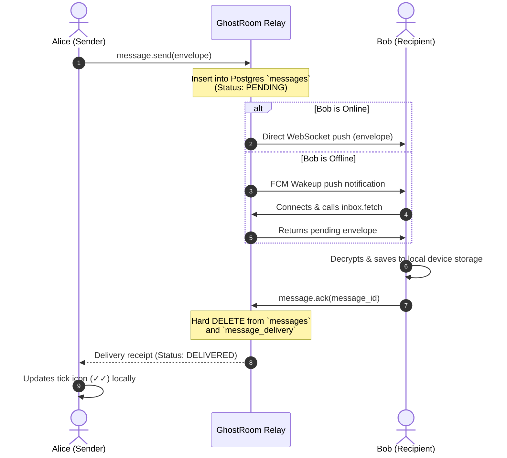

# GhostRoom System Architecture

## 1. Overview & Philosophy

GhostRoom is a sovereign, end-to-end encrypted (E2EE), zero-knowledge messaging system designed with a strict **store-and-forward privacy model** (similar to Signal and WhatsApp):

1. **No Account System**: No phone numbers, email addresses, or usernames. Identity is an Ed25519/X25519 keypair derived deterministically from a 24-word BIP39 mnemonic seed.
2. **Device as Source of Truth**: All decrypted conversation logs and media history reside strictly in local on-device storage (Hive/SQLite). The relay holds **zero permanent message logs**.
3. **Store-and-Forward Transient Relay**: The server acts purely as an encrypted transit postbox. Messages exist in the relay's PostgreSQL database only while in-flight (status: `PENDING`). The moment the recipient's device receives and acknowledges the message (`message.ack`), it is **permanently purged** from the relay database and cache.
4. **Blind Relaying**: The server cannot inspect message plaintexts, recipient metadata beyond transient routing IDs, or media attachments.

---

## 2. Core Components

```
┌────────────────────────────────────────────────────────┐
│                   GhostRoom Client                     │
│        (Flutter - Android, Linux, macOS, Windows)      │
│  - BIP39 Mnemonic Identity Vault                       │
│  - Libsodium Sumo Cryptography                         │
│  - On-Device Hive / SQLite Encrypted Storage           │
│  - Offline Outbox Queue & Real-Time Socket Connection  │
└──────────────────────────┬─────────────────────────────┘
                           │ WebSocket / TLS (Port 4000)
                           ▼
┌────────────────────────────────────────────────────────┐
│                   GhostRoom Relay                      │
│                 (NestJS / TypeScript)                  │
│  - Gateway: Real-Time WebSocket Connection & Routing   │
│  - Anti-Replay: Ephemeral Nonce Challenge Handshake    │
│  - In-Flight Mailbox: Store-and-Forward Queue          │
│  - Rate Limiter: Per-Identity Sliding Window Counters  │
│  - FCM Push Dispatcher: Instant Background Wakeups     │
└──────────────┬───────────────────────────┬─────────────┘
               │                           │
     SQL Query │                           │ Key-Value Fast Path
               ▼                           ▼
┌────────────────────────────┐  ┌────────────────────────┐
│     PostgreSQL 15/16       │  │      Redis 7 / KV      │
│     (System of Record)     │  │  (Ephemeral In-Memory) │
│ - `messages` (In-flight)   │  │ - Auth Nonce Challenges│
│ - `message_delivery`       │  │ - Rate Limit Counters  │
│ - `devices` (FCM tokens)   │  │ - Daily Upload Quotas  │
│ - `media_metadata`         │  │ - Fast Inbox ZSET Cache│
└────────────────────────────┘  └────────────────────────┘
               │
               │ S3 / Presigned URLs
               ▼
┌────────────────────────────────────────────────────────┐
│           Cloudflare R2 / MinIO (Blob Store)           │
│  - Encrypted Media Payloads & Blurred Thumbnails       │
│  - Ephemeral Reference-Counted Lifecycles               │
└────────────────────────────────────────────────────────┘
```

---

## 3. Storage Model

### A. Client-Side (Persistent)
* **Identity Vault**: Stored in platform secure storage (Android Keystore, Apple Keychain, Linux Secret Service).
* **Messages & Contacts**: Stored locally in encrypted Hive boxes.
* **Media Cache**: Stored in application sandbox directory with LRU memory caching.

### B. Relay-Side (Transient Store-and-Forward)
* **`messages` table**:
  * Holds encrypted envelopes awaiting delivery.
  * Deleted immediately when all target deliveries are acknowledged.
* **`message_delivery` table**:
  * Tracks delivery state per device (`PENDING` -> `DELIVERED` -> `ACKNOWLEDGED`).
  * Deleted immediately when acknowledged.
* **`devices` table**:
  * Maps client `identity_id` to its latest `fcm_token` and `platform` for push notifications.
* **`media_metadata` table**:
  * Tracks media blob ID, owner, size, hash, and active reference count.

---

## 4. Message Lifecycle



---

## 5. Security & Cryptographic Invariants

* **Key Derivation**: BIP39 24-word seed phrase + PBKDF2 -> Ed25519 Master Signing Key (`eid`) and X25519 Encryption Key (`xid`).
* **Public ID (`public_id`)**: Base58 encoded Blake2b-160 digest of the Ed25519 public key.
* **Message Encryption**: Hybrid X25519 Key Exchange + XChaCha20-Poly1305 symmetric authenticated encryption.
* **Anti-Replay**: WebSockets require cryptographic signature verification against a random 32-byte nonce (`identity.prove`) with a 60-second TTL.
* **Anti-Abuse**: Per-identity hourly and daily sliding-window rate limits enforced in-memory / Redis.
