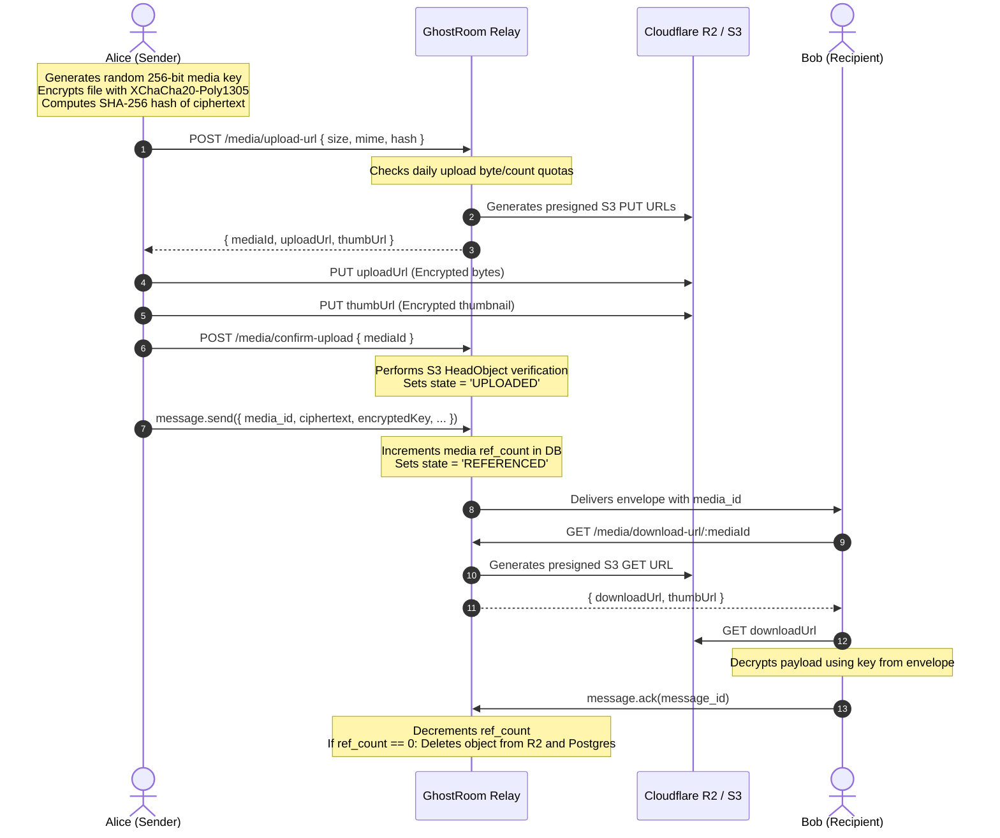

# Zero-Knowledge Media Architecture

GhostRoom supports end-to-end encrypted images, videos, audio notes, and file attachments without allowing the relay server or cloud storage provider to inspect media content or unencrypted thumbnails.

---

## 1. Storage Overview

* **Provider**: Any S3-compatible object storage (Cloudflare R2, MinIO, AWS S3).
* **Payloads**:
  * Bulk Media: `media/{media_id}` (100% encrypted ciphertext).
  * Thumbnail: `thumbs/{media_id}` (100% encrypted preview).
* **Privacy Guarantee**: All symmetric encryption keys and nonces are encapsulated inside the message envelope. The blob storage provider and the relay only hold unreadable ciphertext.

---

## 2. Media Upload & Send Lifecycle



---

## 3. Endpoints

### 1. `POST /media/upload-url`
* **Headers**: `x-public-id: <Sender_Public_ID>`
* **Body**:
  ```json
  {
    "size": 1542030,
    "mime": "image/jpeg",
    "hash": "e3b0c44298fc1c149afbf4c8996fb92427ae41e4649b934ca495991b7852b855"
  }
  ```
* **Response**:
  ```json
  {
    "mediaId": "uuid_v4",
    "uploadUrl": "https://...r2.cloudflarestorage.com/media/...?[presigned-query]",
    "thumbUrl": "https://...r2.cloudflarestorage.com/thumbs/...?[presigned-query]"
  }
  ```

### 2. `POST /media/confirm-upload`
* **Headers**: `x-public-id: <Sender_Public_ID>`
* **Body**:
  ```json
  {
    "mediaId": "uuid_v4"
  }
  ```
* **Response**:
  ```json
  {
    "status": "confirmed"
  }
  ```

### 3. `GET /media/download-url/:id`
* **Headers**: `x-public-id: <Recipient_Public_ID>`
* **Response**:
  ```json
  {
    "downloadUrl": "https://...r2.cloudflarestorage.com/media/...?[presigned-query]",
    "thumbUrl": "https://...r2.cloudflarestorage.com/thumbs/...?[presigned-query]"
  }
  ```

---

## 4. Quotas & Limits

| Type | Maximum Size | Daily Volume Limit | Daily File Count Limit |
| :--- | :--- | :--- | :--- |
| **Images** | 25 MB | 100 MB | 50 files |
| **Videos** | 250 MB | 100 MB | 50 files |
| **Voice Notes** | 10 MB | 100 MB | 50 files |
| **Attachments** | 50 MB | 100 MB | 50 files |

Limits are tracked atomically per public ID in-memory with 24-hour TTL expiration.
