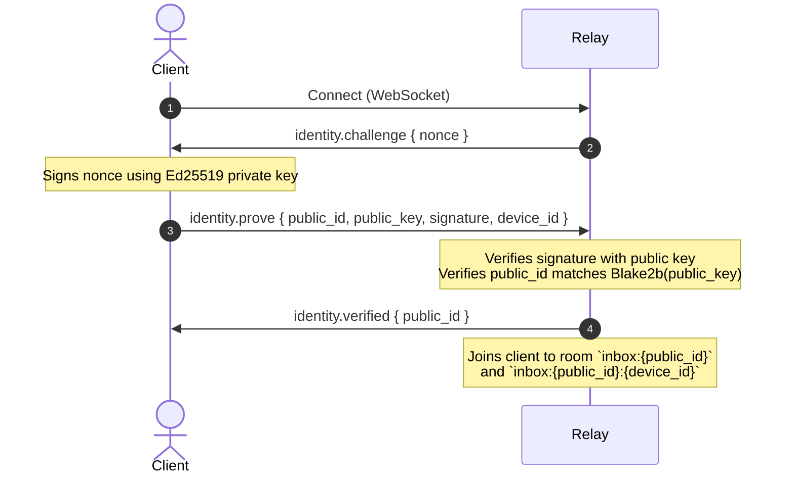

# GhostRoom Wire Protocol Specification

This document details the communication protocol, data structures, and cryptographic specifications between the GhostRoom client and relay server over WebSocket (Socket.IO) and HTTP.

---

## 1. Connection & Authentication Handshake

Every client WebSocket connection must authenticate using an asymmetric challenge-response flow before sending or receiving messages.



### Events:
* **`identity.challenge`** (Server -> Client):
  ```json
  { "nonce": "<64-character hex string>" }
  ```
* **`identity.prove`** (Client -> Server):
  ```json
  {
    "public_id": "8Kx...Base58",
    "public_key": "<Base64 Ed25519 Public Key>",
    "signature": "<Base64 Ed25519 Signature over nonce>",
    "device_id": "device_uuid_v4"
  }
  ```
* **`identity.verified`** (Server -> Client):
  ```json
  {
    "public_id": "8Kx...Base58",
    "status": "authenticated"
  }
  ```

---

## 2. Direct Messaging (`message.send`)

### Request:
Emitted with or without acknowledgement callback:
```json
{
  "target_id": "Recipient_Base58_Public_ID",
  "target_device_id": "optional_device_uuid",
  "id": "uuid_v7",
  "t": 1731680000000,
  "k": "<Base64 Encrypted Ephemeral Key>",
  "n": "<Base64 Nonce>",
  "c": "<Base64 Ciphertext>",
  "s": "<Base64 Sender Signature>",
  "media_id": "optional_media_uuid"
}
```

### Server Action:
1. Validates payload size (max 64 KB).
2. Checks sender rate limit (hourly / daily).
3. If recipient is local:
   * Saves envelope to PostgreSQL `messages` and `message_delivery` (`status: PENDING`).
   * Emits `message.receive` to room `inbox:{recipient_id}` or `inbox:{recipient_id}:{device_id}`.
   * If recipient has registered an FCM device token and is offline, dispatches an FCM background wakeup notification.

---

## 3. Delivery Acknowledgment (`message.ack`)

When the recipient's client receives a message, decrypts it, and saves it into local Hive storage, it immediately emits an acknowledgment:

```json
{
  "message_id": "uuid_v7",
  "device_id": "device_uuid"
}
```

### Server Action:
1. Marks `message_delivery` for this device as `ACKNOWLEDGED`.
2. When all delivery targets are acknowledged:
   * **Hard deletes** the message from `messages`.
   * **Hard deletes** deliveries from `message_delivery`.
   * Decrements attachment media refcount (if `media_id` is present).
3. Emits `message.status_update` to the original sender's inbox:
   ```json
   {
     "message_id": "uuid_v7",
     "status": "DELIVERED",
     "timestamp": 1731680005000,
     "recipient_id": "Recipient_Base58_Public_ID"
   }
   ```

---

## 4. Read Receipts (`message.seen`)

When the recipient opens the conversation and views the message:

```json
{
  "message_id": "uuid_v7"
}
```

### Server Action:
1. Relays `message.status_update` with status `SEEN` to the sender:
   ```json
   {
     "message_id": "uuid_v7",
     "status": "SEEN",
     "timestamp": 1731680010000,
     "recipient_id": "Recipient_Base58_Public_ID"
   }
   ```
2. The sender's client marks the message with a blue double checkmark locally.

---

## 5. Inbox Synchronization (`inbox.fetch`)

When a client reconnects after being offline:

```json
{
  "since": 1731670000000
}
```

### Server Response:
Emits `inbox.messages`:
```json
[
  {
    "id": "uuid_v7",
    "sender_id": "Sender_Base58_Public_ID",
    "recipient_id": "Recipient_Base58_Public_ID",
    "envelope": { ... }
  }
]
```
Client processes each envelope, stores it locally, and sends `message.ack` for each.

---

## 6. Public Portal & HTTP Endpoints

The relay serves public web distribution and routing endpoints without requiring authentication:

| Endpoint | Method | Response Type | Description |
| :--- | :--- | :--- | :--- |
| `/` | `GET` | `text/html` or `application/json` | Public landing page presenting zero-knowledge architecture. Responds with JSON uptime if requested via API client. |
| `/download` | `GET` | `text/html` | Release distribution page with direct binary triggers and SHA-256 integrity verification table. |
| `/connect/:publicId` | `GET` | `text/html` | Smart-redirect page invoking `ghostroom://connect/<publicId>` with 1500ms fallback. |
| `/u/:publicId` | `GET` | `text/html` | Short-URL alias for `/connect/:publicId`. |
| `/.well-known/assetlinks.json` | `GET` | `application/json` | Android App Links verification manifest (`namespace: android_app`, `package_name: com.ghostroom.app`). |
| `/.well-known/apple-app-site-association` | `GET` | `application/json` | iOS Universal Links association manifest (`/connect/*`, `/u/*`). |
| `/status` | `GET` | `application/json` | Lightweight health status (`{ status: "ok", timestamp }`). |
| `/health` | `GET` | `application/json` | Comprehensive health check evaluating database, storage, and FCM. |

---

## 7. Deep Link & URI Schemes

GhostRoom recognizes both custom URI schemes and Universal/App Links:

### URI Formats
1. **Universal App Link**:
   `https://ghost-room-chi.vercel.app/connect/<PUBLIC_ID>`
   `https://ghost-room-chi.vercel.app/u/<PUBLIC_ID>`
2. **Custom Scheme**:
   `ghostroom://connect/<PUBLIC_ID>`
3. **Legacy Identity Package Scheme**:
   `ghostroom://identity/<BASE64_PACKAGE>`
4. **Referral / Invite Web Link**:
   `https://ghost-room-chi.vercel.app/?ref=invite&id=<PUBLIC_ID>`

### Client Intent Handling
- Parsing extracts `<PUBLIC_ID>`.
- App verifies peer against own public ID to prevent self-invites.
- App displays the **Add Contact & Fingerprint Verification Modal** containing public ID, safety numbers, and alias customization.

---

## 8. Encrypted Keyfile Specification (`.ghostkey`)

The `.ghostkey` file is a portable JSON document encapsulating an Argon2id-derived XChaCha20-Poly1305 ciphertext of the mnemonic seed phrase:

```json
{
  "ghostroom_keyfile": "ghostkey",
  "version": 1,
  "public_id": "<Base58 string>",
  "fingerprint": "<Formatted Safety Fingerprint>",
  "kdf": {
    "algorithm": "argon2id13",
    "salt_hex": "<64-char hex string (32 bytes)>",
    "ops_limit": 2,
    "mem_limit": 67108864
  },
  "cipher": {
    "algorithm": "xchacha20poly1305_ietf",
    "nonce_hex": "<48-char hex string (24 bytes)>",
    "ciphertext_hex": "<Hex-encoded ciphertext + 16-byte Poly1305 auth tag>"
  },
  "created_at": "<ISO-8601 timestamp>"
}
```

### Decryption Algorithm:
1. `salt = hexToBytes(salt_hex)`
2. `derivedKey = crypto_pwhash_argon2id13(password, salt, ops_limit, mem_limit, 32)`
3. `plaintext = crypto_aead_xchacha20poly1305_ietf_decrypt(ciphertext, nonce, derivedKey)`
4. `payload = JSON.parse(plaintext)`
5. `mnemonic = payload.mnemonic`

---

## 9. Version Manifest Specification (`version.json`)

The update engine queries `version.json` at the root of the distribution portal:

```json
{
  "version": "2.5.0",
  "build_number": 6,
  "release_date": "2026-11-20T05:03:15Z",
  "release_url": "https://github.com/Sugarcube08/GhostRoom/releases/tag/v2.5.0",
  "changelog": "Changelog summary for v2.5.0...",
  "platforms": {
    "android": {
      "name": "Android Package (APK)",
      "format": "apk",
      "filename": "ghostroom-android.apk",
      "url": "https://.../releases/download/v2.5.0/ghostroom-android.apk",
      "sha256": "c5088874be631971621572ea3152d81992f4166851e26bac28e52efa7d55addc",
      "size_bytes": 82651678
    },
    "linux": {
      "name": "Linux Universal AppImage",
      "format": "appimage",
      "filename": "ghostroom-linux-x86_64.AppImage",
      "url": "https://.../releases/download/v2.5.0/ghostroom-linux-x86_64.AppImage",
      "sha256": "5f9ef09a1dcb8cdd7f06f19d723aeda7dfb45541ecbcf6133c55d88611c8f75d",
      "size_bytes": 12408000
    }
  }
}
```
Client verifies `computed_sha256(downloaded_file) === manifest.sha256` prior to triggering installation.
