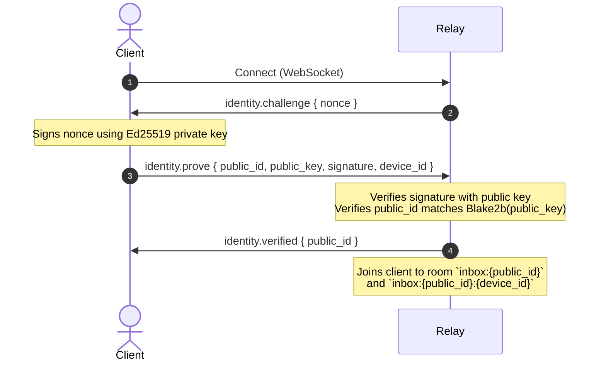

# GhostRoom Wire Protocol Specification

This document details the communication protocol between the GhostRoom client and relay server over WebSocket (Socket.IO).

---

## 1. Connection & Authentication Handshake

Every client WebSocket connection must authenticate using an asymmetric challenge-response flow before sending or receiving messages.



### Events:
* **`identity.challenge`** (Server -> Client):
  ```json
  { "nonce": "<64-character hex string>" }
  ```
* **`identity.prove`** (Client -> Server):
  ```json
  {
    "public_id": "8Kx...Base58",
    "public_key": "<Base64 Ed25519 Public Key>",
    "signature": "<Base64 Ed25519 Signature over nonce>",
    "device_id": "device_uuid_v4"
  }
  ```
* **`identity.verified`** (Server -> Client):
  ```json
  {
    "public_id": "8Kx...Base58",
    "status": "authenticated"
  }
  ```

---

## 2. Direct Messaging (`message.send`)

### Request:
Emitted with or without acknowledgement callback:
```json
{
  "target_id": "Recipient_Base58_Public_ID",
  "target_device_id": "optional_device_uuid",
  "id": "uuid_v7",
  "t": 1731680000000,
  "k": "<Base64 Encrypted Ephemeral Key>",
  "n": "<Base64 Nonce>",
  "c": "<Base64 Ciphertext>",
  "s": "<Base64 Sender Signature>",
  "media_id": "optional_media_uuid"
}
```

### Server Action:
1. Validates payload size (max 64 KB).
2. Checks sender rate limit (hourly / daily).
3. If recipient is local:
   * Saves envelope to PostgreSQL `messages` and `message_delivery` (`status: PENDING`).
   * Emits `message.receive` to room `inbox:{recipient_id}` or `inbox:{recipient_id}:{device_id}`.
   * If recipient has registered an FCM device token and is offline, dispatches an FCM background wakeup notification.

---

## 3. Delivery Acknowledgment (`message.ack`)

When the recipient's client receives a message, decrypts it, and saves it into local Hive storage, it immediately emits an acknowledgment:

```json
{
  "message_id": "uuid_v7",
  "device_id": "device_uuid"
}
```

### Server Action:
1. Marks `message_delivery` for this device as `ACKNOWLEDGED`.
2. When all delivery targets are acknowledged:
   * **Hard deletes** the message from `messages`.
   * **Hard deletes** deliveries from `message_delivery`.
   * Decrements attachment media refcount (if `media_id` is present).
   * Evicts message from Redis inbox cache.
3. Emits `message.status_update` to the original sender's inbox:
   ```json
   {
     "message_id": "uuid_v7",
     "status": "DELIVERED",
     "timestamp": 1731680005000,
     "recipient_id": "Recipient_Base58_Public_ID"
   }
   ```

---

## 4. Read Receipts (`message.seen`)

When the recipient opens the conversation and views the message:

```json
{
  "message_id": "uuid_v7"
}
```

### Server Action:
1. Relays `message.status_update` with status `SEEN` to the sender:
   ```json
   {
     "message_id": "uuid_v7",
     "status": "SEEN",
     "timestamp": 1731680010000,
     "recipient_id": "Recipient_Base58_Public_ID"
   }
   ```
2. The sender's client marks the message with a blue double checkmark locally.

---

## 5. Inbox Synchronization (`inbox.fetch`)

When a client reconnects after being offline:

```json
{
  "since": 1731670000000
}
```

### Server Response:
Emits `inbox.messages`:
```json
[
  {
    "id": "uuid_v7",
    "sender_id": "Sender_Base58_Public_ID",
    "recipient_id": "Recipient_Base58_Public_ID",
    "envelope": { ... }
  }
]
```
Client processes each envelope, stores it locally, and sends `message.ack` for each.
